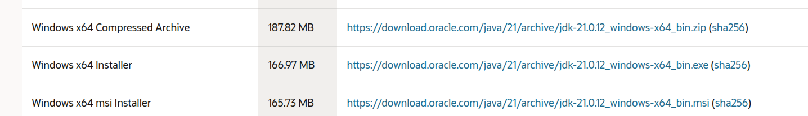
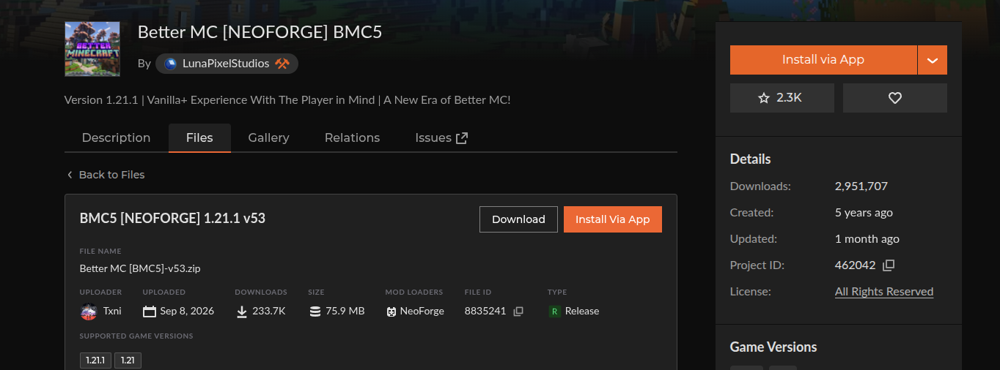
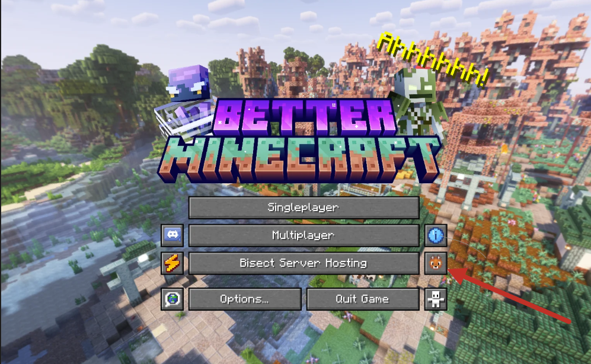
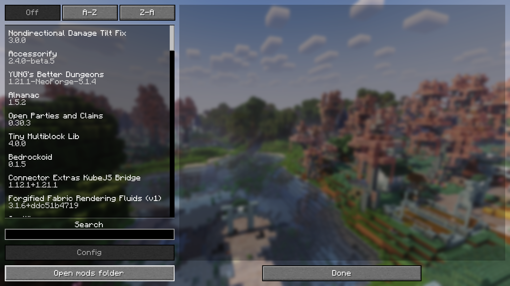

# Minecraft cu fetite Anime si Pokemoni + BMC(Better Minecraft 5)

## 1. Introducere

In acest modpack, am combinat Better Minecraft 6 + alte mod-uri. Acesta este un scurt tutorial pentru a va
seta jocul si a va putea conecta si juca impreuna cu noi.

## 2. Requirements
- Java 21 / Java 25 (il gasesti pe link-ul asta sa-l instalezi) : https://www.oracle.com/java/technologies/javase/jdk21-archive-downloads.html   
- Minecraft 1.21.1 (NeoForge)
- Better Minecraft 5 (v53): https://www.curseforge.com/minecraft/modpacks/better-mc-neoforge-bmc5/files/8835241
- Modpack-ul lui Alexis + alea noi (sunt si mai jos pentru usurinta): https://www.curseforge.com/minecraft/mc-mods/touhou-little-maid/files/8061852
- Pokemoni: https://www.curseforge.com/minecraft/mc-mods/cobblemon/files/9124643
- Unul din serverele noastre de discord: Vladivostok: https://discord.gg/FfAK4hdbKg 

> Le instalati direct cu CurseForge. Prima data instalati BMC5 (Better Minecraft 5), apoi va trebui sa instalti pokemoni si maids. Instaleaza doar BMC5 cu Curseforge si sari la tutorial direct, dupa descarca celelalte. 

### Poti sari direct la tutorial : [Click aici pentru Tutorial](#5-mini-tutorial-pentru-instalare)

### Viziteaza dupa ce ai termian de intalat, problemele frecvente : [Click pentru probleme frecvente stiute].(### Probleme frecvente)

*Uite aici daca vrei o arhiva cu moduri direct daca preferi sa instalezi manual: https://drive.proton.me/urls/NP787X2FAM#xApYpzDVMxFP*

## 3. Lista Moduri Suplimentare peste BMC5 (NeoForge 1.21.1)

*(Au fost eliminate toate modurile care exista deja in **Better MC [BMC5] v53** — precum Biomes O' Plenty, GlitchCore, TerraBlender, FerriteCore, Framework, Sodium, Iris Shaders, Kotlin for Forge, Open Parties and Claims, Xaero's Minimap/World Map, Balm, Client Sort, Cloth Config — precum si cele care intra in conflict cu modurile din BMC6, cum ar fi JEI vs REI, Traveler's Backpack vs Sophisticated Backpacks, Immersive Optimization/VMP vs ServerCore+Lithium sau modurile ramase pe 1.21.1).*

### Probleme frecvente

Cand vei incerca sa intri in meniul de video settings, in mod normal va crash ui deoarece sunt 2 moduri care modifica meniul.

Las aici cele fixurile posibile:

Fix option
- Delete sodiumoptionsmodcompat-neoforge-1.0.0-1.21.1.jar from Instances\Better MC [NEOFORGE] BMC5\mods (il gasesti in C:\Users\<Numele PC-ului>\curseforge\minecraft\Instances\Better MC [NEOFORGE] BMC5\mods). It only adds EMF/ETF config pages inside Sodium's video settings — removing it loses nothing else, and video settings will work again. (Keep sodiumoptionsapi — other mods depend on it.)

### A. Moduri Suplimentare pentru Jucatori + Server (Client & Server)

### B. Moduri Suplimentare doar pentru Server (Server only)

## 4. Moduri Anime / Maids — status pe NeoForge 26.1.2

### A. Ce functioneaza

| Mod | Versiune (26.1.2) | Loader | Sursa / Link | Observatii |
| :--- | :--- | :--- | :--- | :--- |
| **Yes Steve Model (YSM)** | `2.6.5-neoforge+mc26.1-hotfix` | NeoForge nativ | [Modrinth](https://modrinth.com/mod/yes-steve-model/version/1rPJlKDJ) | Deja in lista 3.A — modele anime pentru jucatori |
| **Touhou Little Maid: Tsumugi** | `1.0.23-beta.1+mc26.1.2` | Fabric (prin Connector) | [CurseForge](https://www.curseforge.com/minecraft/mc-mods/touhou-little-maid-tsumugi/files/8859482) | Port Fabric **neoficial** al TLM — singurul build existent pe 26.1.2. Maids cu sarcini (farm, pescuit, gatit, lupta, sortare storage), modele custom + suport YSM, chat LLM/TTS. **Beta — testati pe un server de test intai.** |

### B. Dependente obligatorii pentru TLM Tsumugi (server + TOTI clientii)

| Mod | Versiune | Observatii |
| :--- | :--- | :--- |
| Sinytra Connector | `3.0.0-beta.6+26.1.2` | Deja in lista 3.B |
| Forgified Fabric API | `0.155.3+26.1.2+3.5.9` | Deja in lista 3.B |
| Forge Config API Port | `26.1.5+` | Varianta pentru **26.1**, nu cea de 26.2 |
| Java | 25 | Cerut de ramura 26.1 a modului |

> TLM e mod Client & Server — fiecare jucator trebuie sa aiba in client Connector + FFAPI + Forge Config API Port + jar-ul TLM Tsumugi. Nu e in lista de compatibilitate testata a Connector-ului, deci necesita testare manuala.

## 5. Mini tutorial pentru instalare.

Prima data, este recomandat pentru convenienta, sa instalezi Better Minecraft 5 (BMC5).

Pentru comoditate, recomand sa apesi pe _Install via app_, iar o instanta de CurseForge va incepe.
Nu instala Overwolf.

Dupa ce il instalati un requirement important este sa mergeti pe mod.

Apesi pe Better Minecrft 5. Navigheaza la meniul din puncte verticale

Profile option

Bifeaza Allow content Management

Abia apoi continua instalarea din linkurile de mai sus.
- Modpack-ul lui Alexis + alea noi (sunt si mai jos pentru usurinta): https://www.curseforge.com/minecraft/mc-mods/touhou-little-maid/files/8061852
- Pokemoni: https://www.curseforge.com/minecraft/mc-mods/cobblemon/files/9124643

Dupa acest pas, ruleaza jocul o data. Apoi, din meniul principal al jocului apasa pe butonul de mods:

Apasa apoi pe open mods directory. 

Acolo doar vei copia, din arhive cu modpack-uri suplimentare pe masura ce apar, toate fisierele jar. (Pro tip: Inchide jocul in timp de copieze.)

Enjoy.

## 6. Date de conectare

IP:

NON-premium, pentru toata lumea.
